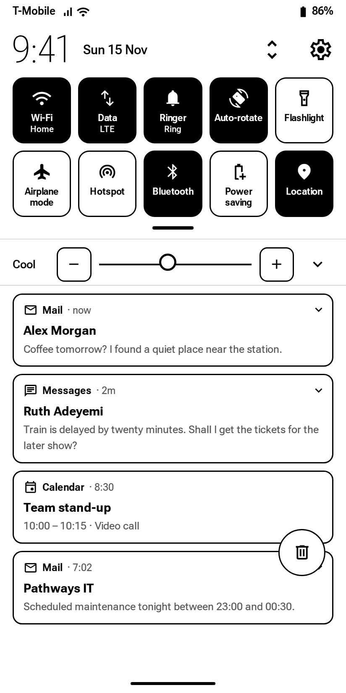
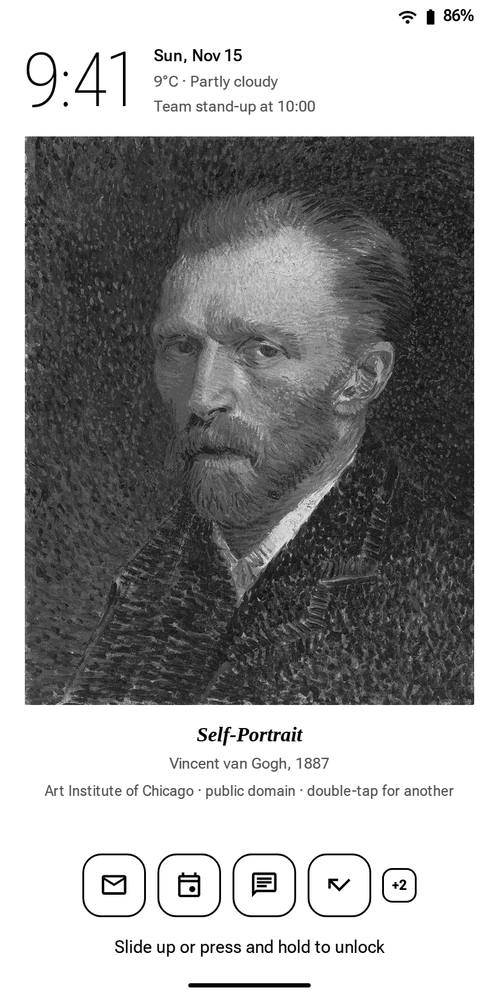
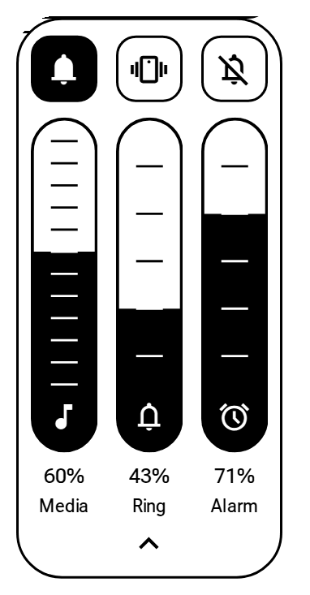

# Android 17 for the Bigme HiBreak Pro (B651, black and white)

An unofficial Android 17 system image for the black-and-white **Bigme HiBreak Pro (B651)** e-ink phone:
[Evolution X](https://evolution-x.org) `cnb` (Android 17) built as a Treble GSI with
[TrebleDroid](https://github.com/TrebleDroid) / [RestlessOS](https://github.com/cawilliamson/treble_restlessos) patches,
plus a set of patches and apps that make it work on this phone's e-ink panel and old (4.19) kernel.

It replaces only the `system` partition. Bigme's stock kernel, boot, vendor and modem stay as they are.

> **Unofficial and unsupported.** Not made or endorsed by Bigme, Evolution X, TrebleDroid or Google. Installing it
> unlocks the bootloader and erases the phone. Read [Risks](#risks) before you start.

> **Early release, tested on one phone.** The Google-apps image runs daily on one HiBreak Pro B651, but always with a
> Magisk-patched boot image. The stock boot that the install guide uses, the vanilla (no Google apps) image and the
> rollback to Bigme stock have not been tested on hardware yet. Only install it if you can recover the phone with
> fastboot, and please report what happens in [Issues](../../issues).

| Shade with front light | Lock screen (painting style) | Volume panel |
|---|---|---|
|  |  |  |

<sub>Design renderings of the shipped layouts (824 × 1648, 16 grey levels like the panel), with made-up names and
messages. The painting is a public-domain work fetched from the Art Institute of Chicago.</sub>

## What you get

- **Android 17** (Evolution X `cnb`, AOSP `android-17.0.0_r1`, security patch 2026-11-01), userdebug build.
- **E-ink display stack**: Bigme's XRZ composer gets full-frame client composition with correct damage, Bigme's
  waveform key is built in, and a one-shot GC16 clear is available to apps. No animations by default
  (0.01 scales), high-contrast text, light theme.
- **HiBreak controller** (from [HiBreakBreak Pro](https://github.com/jaronsjarons/hibreakbreak-pro), built from
  source): per-app refresh modes (Clear / Balanced / Smooth / Fast / Hyper), full refresh, anti-ghosting, front light
  (cool + warm), the side buttons (single / double / long press actions), a **Settings > E-ink display** page.
- **E-ink Shade** (our app, built in as a privileged system app, no root needed): black-and-white quick settings
  (up to 15 tiles), front light section (Cool/Warm, Auto = adaptive brightness, Day/Read/Evening/Bedtime presets),
  notifications as cards, an e-ink volume panel, a lock screen with several styles (painting, clock, words, poetry,
  book, alarm clock, to-do, wallpaper…) and its own PIN pad, and a pre-rendered page for the sleep screen.
- **Sleep picture**: the HiBreakBreak sleep dream shows the lock page / a picture while the screen is off.
- **Loop Habit Tracker, black and white** (a re-skin of [Loop](https://github.com/iSoron/uhabits) 2.3.2) whose habits
  the shade and lock screen can show.
- **Fingerprint** works (a bionic change keeps the MicroArray sensor's TEE calls working on Android 17).
- Checked on the phone: Wi-Fi, Bluetooth, camera, sensors, vibration, sleep/wake, Google services (GApps). Mobile
  network, calls and SMS use Bigme's stock modem and vendor stack unchanged.

Two variants:

| Variant | File | Contents |
|---|---|---|
| **GApps** | `hibreak-pro-a17-<version>-gapps.img.xz` | Google Play Store, Play services and Google apps (Evolution X's built-in set). This is the configuration the developer runs daily. |
| **Vanilla** | `hibreak-pro-a17-<version>-vanilla.img.xz` | No Google apps or services. Same HiBreak features. Has **not** been booted on a phone yet (see [Known issues](KNOWN-ISSUES.md)). |

Downloads, checksums and release notes: [Releases](https://github.com/bottlebrushes/hibreak-pro-a17/releases).

## Requirements

- A **Bigme HiBreak Pro, model B651, black and white** (MediaTek MT6877, fastboot board `k6877v1_64_k419`).
  The HiBreak Pro **Color** has a different panel and has not been tried.
- **Bigme's stock firmware** on the phone (the Android 14 3.x releases). This image keeps the stock vendor partition
  (it reports Android 12 / VNDK 31; that is normal for this phone) and the stock kernel. Tested vendor:
  `Bigme/HiBreak/Smartphone:12/SP1A.210812.016/1769762323`.
- An **A/B phone booting slot a** (the HiBreak Pro is virtual A/B; `fastboot getvar current-slot` shows the slot).
- An **unlockable bootloader** ("OEM unlocking" in Developer options). Unlocking erases the phone.
- A computer (Linux or macOS; Windows works with the same commands typed by hand) with
  [Android platform-tools](https://developer.android.com/tools/releases/platform-tools) (`adb`, `fastboot`), `xz`,
  and about 15 GB of free disk space.
- **The stock firmware for your phone**, kept on the computer: you need its `vbmeta.img` to install and its
  `system.img` to go back. See [docs/ROLLBACK.md](docs/ROLLBACK.md#get-the-stock-images-first).

## Risks

- **All data on the phone is erased** (bootloader unlock, and again when the image is installed). Back up first.
- **Unlocking the bootloader is permanent in practice**: the phone shows an "orange state" warning at every boot.
  Banking apps, Google Wallet tap-to-pay and other apps that require Play Integrity "strong" or "device" integrity
  may refuse to work (see [Known issues](KNOWN-ISSUES.md)).
- **Bricking**: a wrong command can leave the phone unbootable. Staying in fastboot is almost always recoverable by
  flashing the stock images; flashing the wrong partitions (`nvram`, `nvdata`, `protect*`, `proinfo`, `seccfg`,
  `preloader`, `lk`) can lose the IMEI or calibration for good. The scripts here never touch those partitions.
- **Security**: this is a `userdebug` build signed with the **public AOSP test keys** (like most GSIs). Anyone can
  sign an app with those keys and it gets system privileges. Don't use it where that matters.
- **No warranty, no OTA updates.** Updates are new images from this page. Bigme may refuse warranty service for a
  phone whose bootloader has been unlocked.
- The vanilla variant and the stock (un-rooted) boot image have less test time than the GApps variant; see
  [Known issues](KNOWN-ISSUES.md).

## Install

Full step-by-step guide: **[docs/INSTALL.md](docs/INSTALL.md)**. In short:

1. Back up (`scripts/backup.sh`, plus your apps' own backups) and download your stock firmware
   ([docs/ROLLBACK.md](docs/ROLLBACK.md#get-the-stock-images-first)).
2. Unlock the bootloader: `adb reboot bootloader`, `fastboot flashing unlock`.
3. Download the image, then check and unpack it: `scripts/unpack.sh hibreak-pro-a17-<version>-gapps.img.xz`.
4. Install (dry run first, then `--execute`):
   ```sh
   scripts/install.sh --image hibreak-pro-a17-<version>-gapps.img --vbmeta stock/vbmeta.img
   scripts/install.sh --image hibreak-pro-a17-<version>-gapps.img --vbmeta stock/vbmeta.img --execute
   ```
   This flashes `vbmeta_a` (your stock one, with verification off), then `system` in fastbootd, wipes `/data`, and
   reboots. The first boot takes several minutes.

## Rollback to stock

**[docs/ROLLBACK.md](docs/ROLLBACK.md)**: `scripts/rollback-to-stock.sh --stock DIR --execute` writes Bigme's stock
`system` (and, if you extracted them, `system_ext`, `product`, `vendor`, `boot`, `dtbo`) and the stock `vbmeta` back,
then wipes `/data`.

## Known issues

See **[KNOWN-ISSUES.md](KNOWN-ISSUES.md)**. The main ones: a single stock lock-screen frame (~50 ms) can flash when
locking; Google Wallet tap-to-pay doesn't work (no hardware-backed attestation); the shade and controller start only
after the first unlock after a reboot.

## Privacy

The images contain no personal data: no accounts, Wi-Fi networks, adb keys, or preset locations. adb needs to be
switched on and each computer authorised on the phone (`ro.adb.secure=1`, no keys built in). The built-in apps
contact these services only when you use the features:

| Feature | Service |
|---|---|
| Shade weather (lock screen, shade) | [Open-Meteo](https://open-meteo.com) for the forecast; the phone's location, or [GeoJS](https://www.geojs.io) IP geolocation when location is off |
| Lock screen paintings | [Art Institute of Chicago API](https://api.artic.edu/docs/) (public-domain works) |
| GApps variant | Google services, as on any phone with Google apps |

## Source

Everything we changed is in [`source/`](source/): the Android 17 patch series (`source/rom/patches`), the
HiBreak product files (`source/rom/vendor-hibreak`, `source/rom/evo-hibreak.mk`), the E-ink Shade app
(`source/shade`), the Loop black-and-white patch (`source/loop-bw`), the build scripts and the pinned repo manifests.
How to build: [source/README.md](source/README.md).

## Licences and credits

Our own code (patches we wrote, E-ink Shade, scripts, docs) is under the [Apache License 2.0](LICENSE). The images
also contain software and data that are **not ours**; see [NOTICE.md](NOTICE.md). In particular:

- **Google apps** (GApps variant only): proprietary Google software, as shipped by Evolution X and most custom ROMs.
  It is not licensed by us; Google's terms apply.
- **Bigme's e-ink waveform file** (`/system/eink_key`): copied unmodified from Bigme's publicly distributed stock
  firmware; the panel driver needs it. It is Bigme's, not ours.
- Android/AOSP, LineageOS, Evolution X, TrebleDroid, RestlessOS, HiBreakBreak Pro (Apache-2.0 / MIT), Loop Habit
  Tracker (GPL-3.0), and others under their own licences.

"Bigme" and "HiBreak" are Bigme's names, used only to say which phone this is for.
